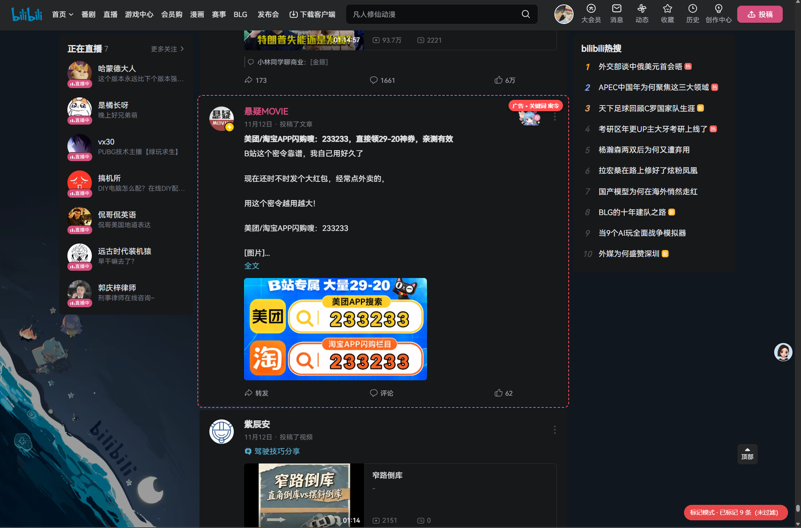
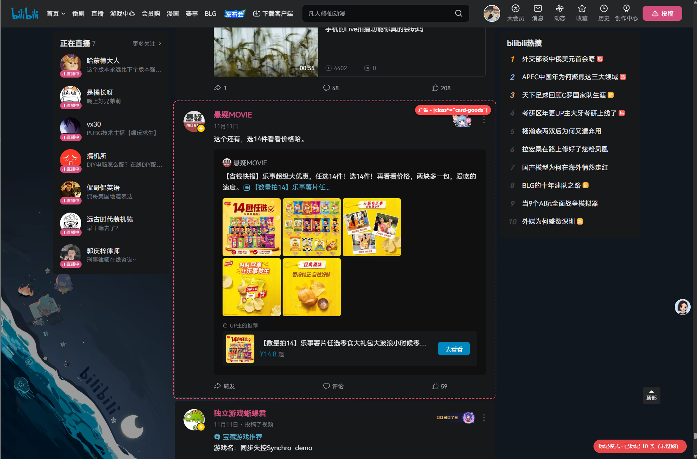

# B 站动态广告过滤（油猴脚本）

过滤 B 站动态列表里的带货广告：带「UP主的推荐」商品卡、淘宝/天猫/京东/拼多多联盟推广链接，以及命中指定营销词的动态。

采用双层过滤：

1. **接口层拦截**：hook `fetch` / `XMLHttpRequest`，在动态列表接口返回 JSON 时直接剔除广告条目，广告根本不会渲染成 DOM。
2. **DOM 层兜底**：对已经渲染出来的动态按商品卡类名、推广链接、关键词判定并隐藏，防止 B 站改版或接口层漏网。

## 效果

「关键词命中」的广告，标签会写明命中的规则：



「商品卡」类型的广告：



## 安装

1. 浏览器安装 [Tampermonkey](https://www.tampermonkey.net/) / Violentmonkey。
2. **重要**：确认油猴已打开「允许用户脚本」（Chrome 扩展管理页右上角也要开启「开发者模式」），否则脚本不会注入。
3. 从本仓库的 `bilibili-dyn-ad-filter.user.js` 点击 **Raw**，油猴会弹出安装页面，点「安装」。
4. 打开 <https://t.bilibili.com/> 即可生效。

支持地址：

- `https://t.bilibili.com/*`
- `https://www.bilibili.com/*`
- `https://space.bilibili.com/*`
- `https://m.bilibili.com/*`

## 两种模式

| 模式 | 行为 |
| --- | --- |
| `filter`（默认） | 真正隐藏/剔除广告 |
| `mark` | 只高亮描边 + 红色标签，不隐藏，用于检查会命中哪些动态 |

切换方式：

- 快捷键 `Alt + Shift + A`
- 控制台：`__biliAdFilter.setMode('mark')` / `__biliAdFilter.setMode('filter')`
- URL 临时进入高亮模式：`https://t.bilibili.com/?adfMark=1`（不写入持久设置）

模式选择保存在浏览器 `localStorage`，刷新后保留。

## 关键词配置

默认关键词：`UP主的推荐`、`淘宝闪购`、`密令`、`淘口令`、`【广告】`

控制台可动态增删，修改后立即生效并保存到本地：

```js
__biliAdFilter.getKeywords()                  // 查看
__biliAdFilter.addKeyword('省钱快报', '大漏')   // 添加（可多个）
__biliAdFilter.removeKeyword('密令')           // 移除（可多个）
__biliAdFilter.resetKeywords()                // 恢复默认
```

也可以直接改脚本里的 `DEFAULT_KEYWORDS` 常量作为新的出厂默认值（控制台配置优先级更高）。

> 关键词只作用于 DOM 兜底层。接口层使用内置的推广域名与 `ADDITIONAL_TYPE_GOODS` 结构特征判定，不读取关键词列表。

## 其他配置

脚本顶部 `CONFIG`：

```js
hideWholeItem: true   // false = 只摘掉商品卡，保留动态文字
hookNetwork: true     // 关闭则只走 DOM 层
showReason: true      // 标记模式下标签是否显示命中原因
showBadge: false      // 过滤模式下是否显示「已过滤 N」角标
watchInterval: 1500   // DOM 兜底轮询间隔(ms)，0 = 关闭
```

控制台辅助：

```js
__biliAdFilter.count()   // { dom: 页面命中数, net: 接口拦截数 }
```

## 说明

- 脚本使用 `@grant none`，不申请额外权限，只依赖标准 Web API。
- 隐藏采用 `data-ad-hidden` 属性 + CSS `!important`，比只写 inline style 更能抵抗 B 站 Vue 重渲染。
- 虚拟列表会复用 DOM 节点，扫描时发现条目不再命中规则会自动撤销标记/恢复显示。
- 接口层与 DOM 层的计数分别统计，角标数字始终按当前 DOM 实际状态计算，不会因重复扫描虚高。

## License

MIT
